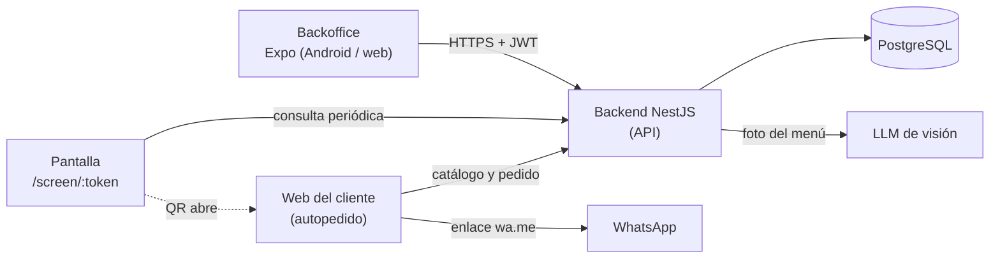

# Mostrador: documento funcional

Los identificadores RF-xxx coinciden con `docs/requerimientos.xlsx` (hoja Requerimientos). Los requerimientos no funcionales están en `docs/no-funcional.md`.

## 1. Resumen del producto

Mostrador (mostrador.io) es una plataforma multi-tenant para comercios con atención al mostrador. Permite que cada comercio:

- cargue su catálogo de productos y el contenido (imágenes y videos) que se muestra en las pantallas del local;
- muestre ese contenido en una pantalla con un código QR permanente;
- reciba pedidos de clientes que escanean el QR, arman un carrito en una web sin instalar nada y envían el pedido por WhatsApp.

Componentes: backoffice (Expo / React Native, Android y web), backend (NestJS + PostgreSQL), reproductor de pantalla (web) y web de autopedido para el cliente.

## 2. Problema y propuesta de valor

**Problema.** Los comercios pequeños atienden pedidos de forma manual: el cliente pregunta qué hay y cuánto cuesta, el empleado responde y anota. Las pantallas del local, si existen, muestran contenido sin conexión con la venta. Las soluciones existentes exigen instalar una app, crear cuentas o contratar la API de WhatsApp Business.

**Propuesta de valor.**

| Para el comercio | Para el cliente |
| --- | --- |
| Pantalla que promociona y vende a la vez | Pedido sin instalar aplicación ni crear cuenta |
| Catálogo propio, cargable desde una foto del menú | Catálogo con fotos y precios en el celular |
| Pedidos ordenados con estado, además del mensaje de WhatsApp | Mensaje de WhatsApp ya armado, solo se envía |
| Costo bajo: sin pagos en línea ni WhatsApp Business API | Proceso en pocos toques |

## 3. Alcance del MVP

**Dentro del alcance:** login y roles; gestión de comercios y locales; catálogo (categorías, productos, imagen, disponibilidad); catálogo desde foto con IA; contenido y pantallas con reproductor y QR; autopedido con carrito; registro de órdenes con estado; configuración de WhatsApp; administración de tenants.

**Releases.** El MVP se entrega en dos releases (detalle y fechas en `docs/planificacion.md`):

- **R1, demo del lunes 02/11/2026:** tenant con slug y subdominio (`local1.localhost` en local), login y roles, backoffice (categorías, productos, contenido de pantalla, pantallas con token, órdenes con cambio de estado, WhatsApp del local), reproductor de pantalla con QR y consulta de cambios, autopedido (catálogo, carrito de 1 a 50 por producto, confirmación, orden guardada y enlace `wa.me` dividido en partes cuando el mensaje es largo) y local sin número de WhatsApp con la orden visible en el backoffice. En R1 el local es único por tenant (se ve y se edita) y el producto tiene imagen (RF-012). R1 incluye también la integridad del pedido y del mensaje (RNF-001) y el QR legible a distancia (RNF-009).
- **R2, desde el 03/11/2026:** catálogo desde una foto con IA, varios locales por tenant con empleados asignados, regeneración del token de pantalla, tenant suspendido, panel Root, métricas, despliegue de producción con certificado wildcard y todo lo que no hace falta para la demostración de punta a punta de R1.

| Release | Historias de usuario |
| --- | --- |
| R1 | HU-02, HU-03, HU-04, HU-06, HU-07, HU-08, HU-09, HU-12, HU-13, HU-14, HU-15, HU-16, HU-17, HU-18, HU-19, HU-20, HU-21, HU-22, HU-23 |
| R2 | HU-10, HU-11 |
| R1 y R2 (cada historia indica qué RF va en cada release) | HU-01, HU-05 |

**Dentro del alcance del MVP completo** (R1 más R2) está lo descrito arriba; la lista anterior de funciones del MVP se reparte entre los dos releases.

**Fuera del alcance del MVP:**

- pagos en línea;
- cuentas de clientes;
- control de stock;
- WhatsApp Business API (se usa el enlace `wa.me`);
- websockets (la pantalla consulta cambios periódicamente);
- promociones generadas por IA como diapositivas;
- sugerencias de productos adicionales en el carrito (upselling).

**Limitación conocida.** El enlace `wa.me` abre WhatsApp con el texto cargado, pero el sistema no puede confirmar que el cliente efectivamente lo envió. Por eso la orden se guarda en el backend antes de abrir WhatsApp. Un local sin número de WhatsApp igualmente recibe pedidos: se registran como "generada" y se ven en el backoffice; solo se omite el paso de `wa.me`. Cuando el mensaje es largo se divide en partes de hasta 1500 caracteres (valor propuesto y configurable); el cliente debe enviar cada parte y el sistema tampoco puede saber si las envió todas.

## 4. Actores y roles

| Actor | Descripción | Puede |
| --- | --- | --- |
| Administrador de plataforma (Root) | Opera Mostrador | Alta, suspensión y reactivación de tenants |
| Dueño del comercio (admin del tenant) | Responsable del comercio | Gestiona locales, empleados, catálogo, contenido, pantallas, WhatsApp y órdenes |
| Empleado / cajero | Atiende en el local | Ve y actualiza el estado de las órdenes de sus locales |
| Cliente anónimo | Persona en el local | Abre el autopedido desde el QR, arma el carrito y envía el pedido |

## 5. Visión de arquitectura

El backend es el centro: el backoffice, el reproductor de pantalla y la web del cliente se comunican solo con él. La web del cliente además abre WhatsApp mediante un enlace.



Notas de multi-tenancy:

- Cada tenant se resuelve por subdominio: `local1.mostrador.io` (RF-002). El `slug` del tenant es único y no puede ser `www`, `api`, `app` ni `admin` (RF-001).
- El local viaja en la ruta o en el QR: `local1.mostrador.io/palermo` (RF-004).
- Un certificado wildcard `*.mostrador.io` cubre todos los subdominios (RNF-013).
- Todo acceso a datos se filtra por el tenant resuelto (RNF-012).
- Lo que ya existe: tenants, usuarios, autenticación JWT con guard global y `@Public`, roles y permisos desde la base, tabla `stores` y versionado SQL.

## 6. Flujos principales

### 6.1 El comercio carga catálogo y contenido
1. El dueño inicia sesión en el backoffice.
2. Crea categorías y productos (precio, imagen, disponibilidad).
3. Sube imágenes y videos, define orden y duración.
4. Registra una pantalla y obtiene su URL con token.
5. Opcionalmente, configura el número de WhatsApp del local (sin número, el local igual recibe pedidos en el backoffice).

### 6.2 La pantalla reproduce contenido
1. El televisor abre `/screen/:token`.
2. El reproductor descarga el contenido y lo muestra en bucle a pantalla completa, con el QR visible siempre.
3. Cada cierto tiempo consulta si hubo cambios y los aplica.
4. Si se cae la red, sigue con el último contenido.

### 6.3 El cliente escanea, pide y envía a WhatsApp
1. El cliente escanea el QR; se abre la web del local.
2. Navega por categorías y agrega productos al carrito.
3. Opcionalmente escribe nota y nombre.
4. Confirma: el backend guarda la orden en estado "generada" con su origen.
5. Si el local tiene número de WhatsApp, se abre WhatsApp con el mensaje armado y el cliente lo envía. Si el mensaje es largo, se divide en partes numeradas y el cliente envía cada una con su botón "Enviar parte N/M". Si el local no tiene número, la web muestra "Tu pedido fue registrado, el comercio lo verá en su panel" y no abre WhatsApp.

### 6.4 El comercio gestiona las órdenes
1. El empleado abre el listado de órdenes del local.
2. Selecciona una orden y cambia su estado (generada, en preparación, lista, entregada o cancelada).

### 6.5 Catálogo desde una foto
1. El dueño fotografía el menú o la góndola.
2. El backend envía la imagen al LLM de visión, que devuelve nombre, precio y categoría.
3. El dueño revisa, corrige o descarta ítems.
4. Al confirmar, los productos se guardan en el catálogo.

## 7. Storyboard

| Flujo | Secuencia de pantallas |
| --- | --- |
| Carga de catálogo y contenido | Login → Inicio del local → Categorías → Lista de productos → Formulario de producto → Contenido de pantalla (subida, orden) → Pantallas (alta, URL) → Configuración de WhatsApp |
| Pantalla | Reproductor con imagen/video + QR fijo → (sin red) mismo contenido sin interrupción → (cambio) nuevo contenido en el siguiente ciclo |
| Autopedido | Escaneo del QR → Catálogo por categorías → Detalle del carrito → Nota y nombre → Confirmar → WhatsApp con mensaje listo (o botones "Enviar parte N/M" si es largo; confirmación simple si el local no tiene número) |
| Órdenes | Login → Lista de órdenes (filtros) → Detalle de orden → Cambio de estado |
| Catálogo desde foto | Botón "Cargar desde foto" → Cámara/galería → Espera del procesamiento → Lista de ítems detectados (editar/descartar) → Confirmar → Catálogo actualizado |

## 8. Historias de usuario

### HU-01 Alta y administración de tenants
Como administrador de plataforma quiero dar de alta, suspender y reactivar comercios con un slug único para que cada uno tenga su propio subdominio.

Requerimientos: RF-001, RF-035

Release: R1 (RF-001) y R2 (RF-035)

```gherkin
Escenario: Alta exitosa
  Dado que soy administrador de plataforma
  Cuando creo un tenant con slug "local1"
  Entonces el tenant queda activo y accesible en local1.mostrador.io

Escenario: Slug reservado
  Dado que soy administrador de plataforma
  Cuando intento crear un tenant con slug "admin"
  Entonces el sistema rechaza el alta indicando que el slug está reservado

Escenario: Slug duplicado
  Dado que existe un tenant con slug "local1"
  Cuando intento crear otro con slug "local1"
  Entonces el sistema rechaza el alta indicando que el slug ya existe

Escenario: Tenant suspendido
  Dado un tenant suspendido
  Cuando un cliente abre su autopedido
  Entonces ve un mensaje de mantenimiento y no puede confirmar pedidos
```

### HU-02 Resolución de tenant por subdominio
Como cliente quiero entrar por la dirección de mi comercio para ver solo su información.

Requerimientos: RF-002

Release: R1

```gherkin
Escenario: Subdominio existente
  Dado un tenant con slug "local1"
  Cuando abro local1.mostrador.io
  Entonces el sistema carga los datos de ese tenant

Escenario: Tenant no encontrado
  Dado que no existe un tenant con slug "inexistente"
  Cuando abro inexistente.mostrador.io
  Entonces recibo un error 404 con un mensaje claro
```

### HU-03 Gestión de locales
Como dueño del comercio quiero crear y editar mis locales con un identificador en la URL para que cada uno tenga su propio QR.

Requerimientos: RF-003, RF-004

Release: R1

```gherkin
Escenario: Crear local
  Dado que soy dueño de un tenant
  Cuando creo el local "Palermo" con slug "palermo"
  Entonces el local queda accesible en local1.mostrador.io/palermo

Escenario: Slug de local duplicado
  Dado que el tenant ya tiene un local con slug "palermo"
  Cuando creo otro local con slug "palermo"
  Entonces el sistema rechaza el alta

Escenario: Local desactivado
  Dado un local desactivado
  Cuando un cliente abre su URL
  Entonces ve que el local no está disponible y no puede pedir
```

### HU-04 Inicio de sesión
Como usuario quiero iniciar sesión en el backoffice para acceder a las funciones de mi rol.

Requerimientos: RF-005, RF-006, RF-009

Release: R1

```gherkin
Escenario: Credenciales válidas
  Dado un usuario registrado
  Cuando ingresa su correo y contraseña correctos
  Entonces accede al backoffice con su sesión iniciada

Escenario: Credenciales inválidas
  Dado un usuario registrado
  Cuando ingresa una contraseña incorrecta
  Entonces ve un error genérico y no se le entrega ningún token

Escenario: Token vencido
  Dado un usuario con sesión vencida
  Cuando intenta abrir una pantalla del backoffice
  Entonces es redirigido al login

Escenario: Ruta pública sin sesión
  Dado un visitante sin sesión
  Cuando abre el autopedido o el reproductor
  Entonces el sistema responde sin pedir login
```

### HU-05 Roles y empleados
Como dueño del comercio quiero crear empleados con un rol y asignarles locales para que solo vean lo que les corresponde.

Requerimientos: RF-007, RF-008

Release: R1 (RF-007) y R2 (RF-008)

```gherkin
Escenario: Alta de empleado
  Dado que soy dueño del comercio
  Cuando creo un empleado con rol "Empleado" para el local "Palermo"
  Entonces el empleado puede ver las órdenes de "Palermo"

Escenario: Acción sin permiso
  Dado un empleado con rol "Empleado"
  Cuando intenta editar el catálogo
  Entonces el sistema responde con acceso denegado

Escenario: Local no asignado
  Dado un empleado asignado solo a "Palermo"
  Cuando consulta las órdenes de otro local
  Entonces no ve ninguna orden de ese local
```

### HU-06 Categorías
Como dueño del comercio quiero administrar categorías para organizar mi catálogo.

Requerimientos: RF-010

Release: R1

```gherkin
Escenario: Crear categoría
  Dado que estoy en el catálogo de mi local
  Cuando creo la categoría "Bebidas"
  Entonces aparece en la lista de categorías

Escenario: Eliminar categoría con productos
  Dado una categoría con productos asociados
  Cuando intento eliminarla
  Entonces el sistema lo impide e indica que tiene productos

Escenario: Nombre repetido
  Dado que existe la categoría "Bebidas"
  Cuando creo otra con el mismo nombre en el mismo local
  Entonces el sistema rechaza el alta
```

### HU-07 Productos e imágenes
Como dueño del comercio quiero cargar productos con precio e imagen para que los clientes los vean.

Requerimientos: RF-011, RF-012

Release: R1

```gherkin
Escenario: Producto válido
  Dado que existe la categoría "Bebidas"
  Cuando creo "Agua 500 ml" con precio 1500,00 y una imagen JPG de 1 MB
  Entonces el producto se guarda y se muestra con su imagen

Escenario: Precio inválido
  Dado el formulario de producto
  Cuando ingreso precio 0 o negativo
  Entonces el sistema rechaza el guardado indicando que el precio debe ser mayor que 0

Escenario: Imagen demasiado grande
  Dado el formulario de producto
  Cuando subo una imagen de 6 MB
  Entonces el sistema la rechaza indicando el límite de 5 MB

Escenario: Imagen en el límite
  Dado el formulario de producto
  Cuando subo una imagen de exactamente 5 MB
  Entonces el sistema la acepta
```

### HU-08 Disponibilidad de productos
Como dueño del comercio quiero marcar un producto como no disponible para que los clientes no lo pidan cuando se agotó.

Requerimientos: RF-013

Release: R1

```gherkin
Escenario: Desactivar producto
  Dado un producto disponible
  Cuando lo marco como no disponible
  Entonces deja de aparecer en el catálogo público

Escenario: Producto inactivo en un carrito abierto
  Dado un cliente con el producto en su carrito
  Cuando el comercio lo marca como no disponible y el cliente confirma
  Entonces el sistema informa que el producto ya no está disponible y no guarda la orden
```

### HU-09 Catálogo público
Como cliente quiero ver el catálogo del local sin registrarme para elegir qué pedir.

Requerimientos: RF-014

Release: R1

```gherkin
Escenario: Catálogo disponible
  Dado un local con productos disponibles
  Cuando consulto su catálogo
  Entonces veo categorías y productos disponibles con precio

Escenario: Catálogo vacío
  Dado un local sin productos disponibles
  Cuando consulto su catálogo
  Entonces veo un mensaje de que aún no hay productos

Escenario: Otro tenant
  Dado un producto que pertenece a otro tenant
  Cuando lo busco desde este local
  Entonces no aparece en el resultado
```

### HU-10 Catálogo desde foto: subida y extracción
Como dueño del comercio quiero fotografiar mi menú para que el sistema detecte los productos.

Requerimientos: RF-015, RF-016

Release: R2

```gherkin
Escenario: Foto legible
  Dado una foto de un menú con 10 productos
  Cuando la envío para procesar
  Entonces recibo una lista con nombre, precio y categoría de los productos detectados

Escenario: Foto sin productos
  Dado una foto que no contiene un menú
  Cuando la envío para procesar
  Entonces el sistema informa que no detectó productos y no guarda nada

Escenario: Respuesta inválida del modelo
  Dado que el modelo devuelve una respuesta que no se puede interpretar
  Cuando termina el procesamiento
  Entonces el sistema muestra un error y permite reintentar

Escenario: Foto demasiado grande
  Dado una foto de 9 MB
  Cuando intento enviarla
  Entonces el sistema la rechaza indicando el límite de 8 MB
```

### HU-11 Catálogo desde foto: revisión y confirmación
Como dueño del comercio quiero revisar y corregir lo detectado antes de guardar para evitar errores en el catálogo.

Requerimientos: RF-017

Release: R2

```gherkin
Escenario: Confirmar con correcciones
  Dado una lista de productos detectados
  Cuando corrijo un precio y confirmo
  Entonces se guardan los productos con el precio corregido

Escenario: Descartar ítems
  Dado una lista de productos detectados
  Cuando descarto dos ítems y confirmo
  Entonces esos dos ítems no se guardan

Escenario: Salir sin confirmar
  Dado una lista de productos detectados
  Cuando salgo sin confirmar
  Entonces no se guarda ningún producto
```

### HU-12 Contenido de pantalla
Como dueño del comercio quiero subir imágenes y videos y definir su orden y duración para controlar lo que se muestra.

Requerimientos: RF-018, RF-019

Release: R1

```gherkin
Escenario: Subir imagen
  Dado que estoy en Contenido de pantalla
  Cuando subo una imagen válida
  Entonces aparece al final de la lista de reproducción

Escenario: Formato no soportado
  Dado que estoy en Contenido de pantalla
  Cuando subo un archivo .exe
  Entonces el sistema lo rechaza indicando los formatos permitidos

Escenario: Video excede el límite
  Dado que estoy en Contenido de pantalla
  Cuando subo un video de 80 MB
  Entonces el sistema lo rechaza indicando el límite de 50 MB

Escenario: Duración fuera de rango
  Dado una imagen en la lista
  Cuando fijo su duración en 2 segundos
  Entonces el sistema indica que el mínimo es 3 segundos

Escenario: Reordenar
  Dado dos contenidos en la lista
  Cuando cambio su orden
  Entonces la pantalla los reproduce en el nuevo orden
```

### HU-13 Alta de pantallas
Como dueño del comercio quiero registrar una pantalla y obtener su URL para abrirla en el televisor.

Requerimientos: RF-020

Release: R1

```gherkin
Escenario: Crear pantalla
  Dado que estoy en Pantallas
  Cuando registro la pantalla "Entrada"
  Entonces obtengo una URL /screen/<token> única

Escenario: Regenerar token
  Dado una pantalla registrada
  Cuando regenero su token
  Entonces la URL anterior deja de funcionar
```

### HU-14 Reproductor y QR
Como comercio quiero que la pantalla muestre mi contenido y un QR fijo para que los clientes puedan pedir.

Requerimientos: RF-021, RF-022

Release: R1

Calidad asociada (RNF-009): el QR debe leerse a 1,5 m en al menos 95% de 20 intentos con 3 celulares distintos y su lado debe ser al menos 8% del alto de la pantalla; es responsabilidad del reproductor.

```gherkin
Escenario: Reproducción en bucle
  Dado una pantalla con 3 contenidos
  Cuando abro /screen/<token> en el televisor
  Entonces se reproducen en orden y vuelven a empezar al terminar

Escenario: QR permanente
  Dado el reproductor en ejecución
  Cuando cambia el contenido
  Entonces el QR sigue visible y abre el autopedido del local

Escenario: Token inválido
  Dado un token inexistente
  Cuando abro /screen/<token>
  Entonces veo un mensaje de pantalla no válida

Escenario: Pantalla sin contenido
  Dado una pantalla sin contenidos
  Cuando abro su URL
  Entonces veo una imagen por defecto con el QR visible
```

### HU-15 Actualización y continuidad de la pantalla
Como comercio quiero que la pantalla se actualice sola y no se corte si falla internet.

Requerimientos: RF-023, RF-024

Release: R1

```gherkin
Escenario: Contenido actualizado
  Dado el reproductor en ejecución
  Cuando el dueño cambia el contenido
  Entonces el reproductor lo muestra en el siguiente ciclo de consulta, sin recargar manualmente

Escenario: Pérdida de red
  Dado el reproductor con contenido descargado
  Cuando se pierde la conexión
  Entonces sigue reproduciendo el último contenido

Escenario: Red recuperada
  Dado el reproductor sin red
  Cuando vuelve la conexión
  Entonces sincroniza los cambios sin interrumpir la reproducción

Escenario: Sin red desde el inicio
  Dado un televisor que abre la URL sin conexión y sin contenido guardado
  Cuando carga la página
  Entonces muestra un mensaje de espera y reintenta
```

### HU-16 Abrir el autopedido desde el QR
Como cliente quiero escanear el QR y pedir sin instalar nada.

Requerimientos: RF-025

Release: R1

```gherkin
Escenario: QR válido
  Dado el QR de la pantalla "Entrada" del local "Palermo"
  Cuando lo escaneo
  Entonces se abre el catálogo de "Palermo" y el origen queda asociado a esa pantalla

Escenario: Local inexistente
  Dado un QR cuyo local fue eliminado
  Cuando lo escaneo
  Entonces veo una página de error que indica que el local no existe

Escenario: Tenant no encontrado
  Dado un QR con un subdominio inexistente
  Cuando lo escaneo
  Entonces veo un error 404
```

### HU-17 Navegar el catálogo
Como cliente quiero recorrer el catálogo por categorías para encontrar lo que quiero.

Requerimientos: RF-026

Release: R1

```gherkin
Escenario: Ver categoría
  Dado el catálogo del local
  Cuando elijo la categoría "Bebidas"
  Entonces veo sus productos con foto y precio

Escenario: Categoría sin productos disponibles
  Dado una categoría cuyos productos están todos no disponibles
  Cuando abro el catálogo
  Entonces esa categoría no aparece

Escenario: Producto sin imagen
  Dado un producto sin imagen
  Cuando lo veo en el catálogo
  Entonces se muestra una imagen por defecto
```

### HU-18 Carrito
Como cliente quiero agregar, quitar y cambiar cantidades para ver cuánto voy a pagar.

Requerimientos: RF-027

Release: R1

```gherkin
Escenario: Agregar productos
  Dado el catálogo abierto
  Cuando agrego 2 unidades de "Agua 500 ml" a 1500,00 cada una
  Entonces el carrito muestra un total de 3000,00

Escenario: Quitar producto
  Dado un producto en el carrito
  Cuando lo quito
  Entonces desaparece y el total se recalcula

Escenario: Cantidad máxima
  Dado un producto con 50 unidades en el carrito
  Cuando intento agregar una más
  Entonces el sistema no permite superar 50

Escenario: Cantidad limitada por stock
  Dado un producto con stock disponible menor que 50
  Cuando intento agregar m?s unidades que el stock
  Entonces el carrito no permite superar las unidades disponibles

Escenario: Recarga de página
  Dado un carrito con productos
  Cuando recargo la página
  Entonces el carrito se conserva
```

### HU-19 Confirmar el pedido
Como cliente quiero confirmar mi pedido, con nota y nombre opcionales, y que se abra WhatsApp con el mensaje listo.

Requerimientos: RF-028, RF-029

Release: R1

```gherkin
Escenario: Confirmación exitosa
  Dado un carrito con productos
  Cuando escribo mi nombre y confirmo
  Entonces el sistema guarda la orden como "generada" y abre WhatsApp con el mensaje armado

Escenario: Carrito vacío
  Dado un carrito vacío
  Cuando intento confirmar
  Entonces el sistema lo impide e indica que agregue productos

Escenario: Producto que dejó de estar disponible
  Dado un carrito con un producto que el comercio desactivó
  Cuando confirmo
  Entonces el sistema informa qué producto no está disponible y pide revisar el carrito

Escenario: Nota en el límite
  Dado el campo de nota
  Cuando escribo 200 caracteres
  Entonces se acepta; con 201 el sistema indica el máximo

Escenario: Sin nota ni nombre
  Dado un carrito con productos
  Cuando confirmo sin completar nota ni nombre
  Entonces el pedido se registra igualmente

Escenario: Local sin número de WhatsApp
  Dado un local sin número de WhatsApp configurado
  Cuando confirmo el pedido
  Entonces el sistema guarda la orden como "generada" y no abre WhatsApp
  Y muestra "Tu pedido fue registrado, el comercio lo verá en su panel"
```

### HU-20 Registro de la orden
Como comercio quiero que cada pedido quede guardado con su origen para no depender solo de WhatsApp.

Requerimientos: RF-030

Release: R1

```gherkin
Escenario: Orden registrada
  Dado un pedido confirmado desde la pantalla "Entrada"
  Cuando el backend lo procesa
  Entonces guarda ítems, total, estado "generada" y origen "Entrada"

Escenario: Precio manipulado
  Dado un pedido cuyos precios no coinciden con el catálogo
  Cuando el backend lo recibe
  Entonces recalcula el total con los precios vigentes

Escenario: Local sin número de WhatsApp
  Dado un local sin número configurado
  Cuando un cliente confirma un pedido
  Entonces el backend registra la orden con estado "generada"
  Y la orden es visible en el backoffice
```

### HU-21 Gestión de órdenes
Como empleado quiero ver las órdenes del local y cambiar su estado para organizar la atención.

Requerimientos: RF-031, RF-032

Release: R1

```gherkin
Escenario: Listado
  Dado órdenes del local
  Cuando abro el listado
  Entonces veo primero las más recientes

Escenario: Sin órdenes
  Dado un local sin órdenes
  Cuando abro el listado
  Entonces veo un mensaje de que aún no hay órdenes

Escenario: Cambio de estado válido
  Dado una orden "generada"
  Cuando la paso a "en preparación"
  Entonces el estado se actualiza y queda registrado quién lo cambió

Escenario: Transición inválida
  Dado una orden "entregada"
  Cuando intento pasarla a "generada"
  Entonces el sistema lo rechaza
```

### HU-22 Número de WhatsApp del local
Como dueño del comercio quiero configurar el número de WhatsApp que recibe los pedidos, sabiendo que es opcional: sin número igual recibo los pedidos en el backoffice.

Requerimientos: RF-033

Release: R1

```gherkin
Escenario: Número válido
  Dado la configuración del local
  Cuando guardo +5491112345678
  Entonces el número queda configurado

Escenario: Número inválido
  Dado la configuración del local
  Cuando ingreso "12345" o letras
  Entonces el sistema rechaza el valor indicando el formato internacional

Escenario: Número vacío
  Dado la configuración del local
  Cuando borro el número y guardo
  Entonces el local sigue recibiendo pedidos en el backoffice y la web del cliente omite el paso de WhatsApp
```

### HU-23 Mensaje de WhatsApp
Como cliente quiero que el mensaje salga ya armado para enviarlo sin escribir.

Requerimientos: RF-034

Release: R1

```gherkin
Escenario: Mensaje completo
  Dado una orden con 2 ítems, nota y nombre
  Cuando se genera el enlace wa.me
  Entonces el texto incluye local, ítems, cantidades, total, nota y nombre, codificado para URL

Escenario: El mensaje cabe en una sola parte
  Dado una orden cuyo texto formateado tiene 1500 caracteres o menos
  Cuando se genera el enlace wa.me
  Entonces se genera una única parte con el encabezado "Pedido #123" y un solo botón para enviarla

Escenario: El mensaje necesita dos o más partes
  Dado una orden cuyo texto formateado supera 1500 caracteres
  Cuando se generan los enlaces
  Entonces el texto se divide en partes numeradas ("Pedido #123 — parte 1/2", "Pedido #123 — parte 2/2") de hasta 1500 caracteres cada una
  Y cada parte tiene su propio enlace wa.me y la pantalla muestra un botón "Enviar parte N/M" por parte

Escenario: Un ítem nunca se divide entre partes
  Dado una orden cuyo corte de 1500 caracteres cae en medio de la línea de un ítem
  Cuando se divide el mensaje
  Entonces la línea completa del ítem pasa a la parte siguiente
  Y cada ítem aparece completo en una sola parte

Escenario: Caracteres especiales
  Dado una nota con tildes, "&" y saltos de línea
  Cuando se genera el enlace
  Entonces el texto llega a WhatsApp sin alteraciones

Escenario: El cliente no envía el mensaje
  Dado que se abrió WhatsApp con el mensaje
  Cuando el cliente cierra sin enviar
  Entonces la orden permanece "generada" en el backoffice (el sistema no puede saber si se envió)

Nota: el mensaje partido se envía parte por parte; cada parte lleva el número de pedido y "parte N/M" para que el local pueda reconstruirlo aunque lleguen desordenadas o falte alguna.
```

## 9. Trazabilidad

Todos los RF (RF-001 a RF-035) están cubiertos por al menos una historia (HU-01 a HU-23). Cada historia lleva su release (R1 o R2) y coincide con la columna Release de `docs/requerimientos.xlsx`. Los casos de prueba se vincularán en la matriz de trazabilidad de `docs/testing.md`.
